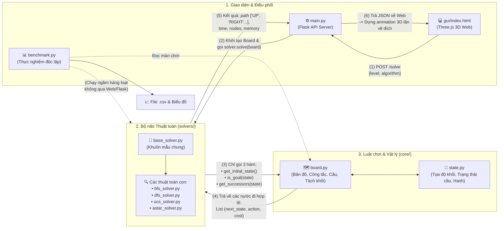

# 🟦 ĐỒ ÁN 1: BLOXORZ SOLVER (CSC14003 - CƠ SỞ TRÍ TUỆ NHÂN TẠO)

> **📌 LƯU Ý QUAN TRỌNG DÀNH CHO THÀNH VIÊN NHÓM & CÔNG CỤ AI (GEMINI PRO / CHATGPT):**
>
> 1. File `README.md` này đã **tóm tắt toàn bộ đề bài PDF của thầy, bảng giải đáp Q&A, luật chơi chi tiết, kiến trúc code có sẵn và hướng dẫn từng nhiệm vụ**. Anh em chưa kịp đọc file PDF của thầy chỉ cần đọc kỹ file này từ trên xuống dưới là nắm được 100% yêu cầu.
>
> 2. Nếu bạn dùng AI (Gemini / ChatGPT) để hỗ trợ viết code hoặc viết báo cáo, **hãy copy toàn bộ nội dung file `README.md` này gửi cho AI trước** để AI hiểu chính xác các hàm có sẵn của nhóm, tuyệt đối không tự ý sửa các file trong `Source/core/`.
>
> 3. **QUY TẮC GIT BẮT BUỘC:** Anh em **KHÔNG push thẳng lên nhánh `main`**. Mỗi người tự tạo branch riêng cho phần việc của mình, code và test kỹ bằng lệnh `python Source/benchmark.py`, sau đó push lên branch đó rồi báo Trưởng nhóm (hoặc thành viên khác) kiểm tra và merge vào `main`!

---

## 1. TÓM TẮT ĐỀ BÀI PDF & GIẢI ĐÁP Q&A CỦA THẦY (CHO ANH EM CHƯA ĐỌC ĐỀ)

### 1.1. Luật chơi Bloxorz (Cần nắm rõ để hiểu thuật toán & đi vấn đáp)

* **Mục tiêu:** Điều khiển một khối hình hộp chữ nhật kích thước `1x1x2` lăn trên bàn cờ sao cho khối **rơi thẳng đứng (STANDING)** vào đúng ô lỗ đích (`Goal hole`). Nếu khối chỉ nằm ngang qua lỗ đích thì chưa thắng; nếu bất kỳ phần nào của khối lăn ra ngoài bàn cờ hoặc đè lên ô trống (`Void`) thì thua.

* **3 Trạng thái hướng của khối `1x1x2` (Orientation):**

  * `STANDING (0)`: Đứng thẳng trên 1 ô `(r, c)`.

  * `LYING_H (1)`: Nằm ngang chiếm 2 ô `(r, c)` và `(r, c+1)`.

  * `LYING_V (2)`: Nằm dọc chiếm 2 ô `(r, c)` và `(r+1, c)`.

* **Các ô đặc biệt (Advanced Tiles - Bắt buộc cả Game và Solver phải xử lý được):**

  * **Ô dễ vỡ (`Fragile tile` - màu cam, mã `2`):** Chỉ chịu được sức nặng khi khối **nằm ngang hoặc nằm dọc**. Nếu khối **đứng thẳng (`STANDING`)** trên ô màu cam, gạch sẽ vỡ và khối rơi xuống vực (nước đi không hợp lệ).

  * **Cầu (`Bridges`):** Các ô cầu có thể Đóng hoặc Mở, được điều khiển bởi công tắc (`Switch`). Khi cầu đóng, nó giống như ô trống (`Void`); khi cầu mở, nó giống gạch thường (`Floor tile`). **Lưu ý sống còn:** Trạng thái tìm kiếm (`State`) bắt buộc phải lưu cả trạng thái Đóng/Mở của mọi cây cầu trên bản đồ!

  * **3 loại Công tắc (`Switches`):**

    1. **Soft switch (Hình tròn/bát giác):** Kích hoạt khi bất kỳ phần nào của khối chạm vào (dù đứng hay nằm).

    2. **Heavy switch (Hình chữ X):** Chỉ kích hoạt khi khối `1x1x2` **đứng thẳng (`STANDING`)** đè toàn bộ trọng lượng lên nó (nằm đè lên không kích hoạt được).

    3. **Split switch (Dấu ngoặc đơn `()` - màu tím):** Chỉ kích hoạt khi khối **đứng thẳng** trên nó. Nó sẽ dịch chuyển tức thời (`teleport`) khối tới 2 vị trí định trước và **tách khối thành 2 khối lập phương đơn `1x1x1` (`SPLIT`)**. Người chơi điều khiển từng khối đơn một (bấm phím `Space` để đổi khối điều khiển). Khi 2 khối đơn di chuyển đến 2 ô kề cạnh nhau, chúng **tự động ghép lại** thành khối `1x1x2` ban đầu. Khối đơn `1x1x1` bấm được Soft switch nhưng **không bấm được Heavy switch** và **không thể tự rơi xuống lỗ đích để thắng**.

  * **Hành vi công tắc:** Có thể là `toggle` (mỗi lần chạm sẽ đảo trạng thái Đóng <-> Mở của cầu) hoặc `permanent` (chuyển cầu sang trạng thái cố định).

### 1.2. Cơ cấu 100 điểm của Đồ án

1. **Reimplement the Game & GUI (20 điểm):**

   * Core mechanics (10 điểm): Bàn cờ cơ bản, lăn khối 4 hướng, kiểm tra rơi/thắng.

   * Advanced tiles (10 điểm): Ô dễ vỡ, cầu và đủ 3 loại công tắc (Soft, Heavy, Split).

2. **4 Thuật toán tìm kiếm bằng Python (40 điểm - mỗi thuật toán 10 điểm):**

   * **BFS Solver (10đ):** Tìm kiếm theo chiều rộng.

   * **DFS / IDS Solver (10đ):** Tìm kiếm theo chiều sâu (có kiểm soát lặp trạng thái) hoặc Lặp sâu dần (Iterative Deepening Search).

   * **UCS Solver (10đ):** Tìm kiếm chi phí cực tiểu. **Lưu ý:** Nếu mọi bước đi đều có `cost = 1` thì UCS biến thành BFS; do đó bắt buộc phải tự thiết kế hàm chi phí không đồng nhất (Non-uniform cost function) và giải thích lý do trong báo cáo.

   * **A* Solver (10đ):** Tìm kiếm A* với hàm Heuristic ước lượng khoảng cách tới đích. Phải giải thích cách thiết kế và chứng minh tính **Admissible** (không đánh giá quá cao chi phí thực tế) / **Consistent** tương ứng với hàm Cost đã chọn.

3. **Báo cáo PDF - Report (30 điểm):**

   * **Phân công công việc & % Hoàn thành:** Điểm cá nhân = Điểm nhóm x % Hoàn thành của thành viên đó.

   * **Mô tả thuật toán (10đ):** Giải thích chi tiết BFS, DFS/IDS, UCS, A* và cách mô hình hóa bài toán (State representation, Actions, Transition model, Goal test, Cost function, Heuristics, tránh lặp trạng thái).

   * **Thực nghiệm - Experiments (20đ):** Chạy thử nghiệm trên bộ test cases chia theo độ khó tăng dần. Đo đủ 4 thông số: **Search Time**, **Peak Memory Usage**, **Expanded Nodes**, **Solution Length**. Trình bày bằng **Bảng số liệu (Tables)**, **Biểu đồ (Charts/Plots)** và nhận xét ưu/nhược điểm của từng thuật toán.

   * **References & Appendix:** Trích dẫn mọi nguồn tham khảo (link GitHub, tài liệu) và **ghi lại cách nhóm sử dụng AI (LLMs) kèm các câu Prompts đã dùng**.

4. **Video Demo YouTube (10 điểm):**

   * Quay giao diện GUI 3D (5đ) và quá trình chơi thủ công + bấm nút chạy các Solver tự lăn về đích (5đ), có **phụ đề hoặc thuyết minh** (Tiếng Việt hoặc Tiếng Anh), up lên YouTube ở chế độ Public và dán link vào báo cáo.

### 1.3. Tổng hợp 7 câu trả lời của Thầy trong bảng Q&A

1. **Test case dùng nguồn có sẵn trên mạng được không?** $\rightarrow$ Được.

2. **Số lượng test case tối thiểu là bao nhiêu?** $\rightarrow$ Tối thiểu **10 test cases** (Nhóm mình đã làm sẵn **12 màn chơi** chia đều 4 cấp độ khó).

3. **Báo cáo viết bằng tiếng Anh hay tiếng Việt?** $\rightarrow$ Tùy nhóm, nhưng **phải thống nhất 1 ngôn ngữ**, tránh nửa Anh nửa Việt.

4. **Khi bấm nút Solve thì GUI hiện đáp án thế nào?** $\rightarrow$ **GUI tự động cho khối sắt lăn từng bước đến đích luôn.**

5. **Có được dùng Source Code game có sẵn không?** $\rightarrow$ Được (nhớ trích dẫn/cite đầy đủ trong báo cáo).

6. **Tiêu chí của GUI là gì?** $\rightarrow$ **Phải là 3D.**

7. **GUI code bằng ngôn ngữ khác được không?** $\rightarrow$ Được (ví dụ JavaScript/Three.js), chỉ cần **riêng phần thuật toán bắt buộc viết bằng Python**.

**⚠️ Cảnh báo từ đề bài:** Giảng viên có quyền gọi **vấn đáp ngẫu nhiên (oral interviews)** để kiểm tra kiến thức thực sự của từng thành viên về dự án. Mọi hành vi đạo văn hoặc gian lận sẽ bị 0 điểm toàn bộ môn học.

---

## 2. TRẠNG THÁI HIỆN TẠI CỦA DỰ ÁN (NHỮNG GÌ ĐÃ XONG vs. CẦN LÀM TIẾP)

Trưởng nhóm đã xây dựng hoàn chỉnh toàn bộ **Bộ khung lõi (`core/`)**, **12 màn chơi chuẩn**, **Công cụ kiểm tra & xuất biểu đồ tự động**, **Thuật toán mẫu BFS**, và **Giao diện Web 3D chạy được đầy đủ tính năng (kể cả Split switch)**.

| Đường dẫn File | Trạng thái | Mô tả chi tiết |
| :--- | :---: | :--- |
| `Source/core/state.py` | ✅ **ĐÃ XONG 100%** | Định nghĩa class `State` bất biến (hashable) lưu tọa độ, 4 hướng (`STANDING`, `LYING_H`, `LYING_V`, `SPLIT`) và trạng thái đóng/mở của mọi cây cầu (`bridges_mask`). **Tuyệt đối không sửa.** |
| `Source/core/board.py` | ✅ **ĐÃ XONG 100%** | Đọc file JSON map, kiểm tra nước đi hợp lệ (rơi xuống Void, vỡ gạch cam Fragile, cầu đóng), xử lý đủ 3 công tắc (`soft`, `heavy`, `split` tách/gộp khối). **Tuyệt đối không sửa.** |
| `Source/solvers/base_solver.py` | ✅ **ĐÃ XONG 100%** | Class cha tự động bấm giờ (`Search Time`), đo đỉnh bộ nhớ (`Peak Memory` bằng `tracemalloc`), đếm `Expanded Nodes` và `Solution Length`. **Tuyệt đối không sửa.** |
| `Source/main.py` | ✅ **ĐÃ XONG 100%** | Server Flask kết nối Python với GUI 3D. **Đã cài cơ chế tự động nạp thuật toán**: hễ ai code xong file solver nào là server tự nhận diện, không cần sửa `main.py`. |
| `Source/levels/level_01..12.json` | ✅ **ĐÃ XONG 100%** | Đã có đủ **12 màn chơi chuẩn** chia làm 4 nhóm độ khó tăng dần (từ 7 bước đến 31 bước, mở rộng >1000 nodes), đã kiểm chứng giải được 100%. |
| `Source/validate_levels.py` | ✅ **ĐÃ XONG 100%** | Script tự động kiểm tra toàn bộ các màn chơi trong `Source/levels/` xem có hợp lệ và giải được (`SOLVABLE`) hay không. |
| `Source/benchmark.py` | ✅ **ĐÃ XONG 100%** | Script tự động chạy mọi thuật toán hiện có trên cả 12 map, kiểm tra tính hợp lệ của đường đi, xuất bảng `benchmark_results.csv` và vẽ 4 biểu đồ `.png` vào `Source/results/`. |
| `Source/solvers/bfs_solver.py` | ✅ **ĐÃ XONG 100%** | Thuật toán `BFSSolver` hoàn chỉnh. Các bạn code thuật toán khác hãy mở file này ra xem làm mẫu. |
| `Source/solvers/dfs_solver.py` | ❌ **CẦN LÀM** | Cài đặt `class DFSSolver(BaseSolver)` dùng Stack + `visited` tránh chu trình lặp. |
| `Source/solvers/ids_solver.py` | ❌ **CẦN LÀM** | Cài đặt `class IDSSolver(BaseSolver)` tìm kiếm lặp sâu dần (Iterative Deepening Search). |
| `Source/solvers/ucs_solver.py` | ❌ **CẦN LÀM** | Cài đặt `class UCSSolver(BaseSolver)` dùng `heapq` với hàm Cost không đồng nhất (quy ước ở Mục 5.4). |
| `Source/solvers/astar_solver.py` | ❌ **CẦN LÀM** | Cài đặt `class AStarSolver(BaseSolver)` dùng `heapq` với hàm Heuristic đảm bảo tính Admissible (xử lý cả cổng dịch chuyển `split`). |
| `Source/gui/index.html` | 🚧 **CẦN NÂNG CẤP** | Giao diện 3D (`Three.js`) đã chơi và chạy auto-roll được mọi tính năng. Bạn phụ trách GUI cần làm đẹp thêm (thêm nút `Solve IDS`, xoay camera bằng chuột `OrbitControls`, vẽ viền khối sắc nét, làm mượt hoạt ảnh lăn). |
| `Report.pdf` & `Video Demo` | ❌ **CẦN LÀM** | Viết báo cáo lý thuyết + phân tích thực nghiệm (30 điểm) và quay Video Demo up YouTube (10 điểm). |

---

## 3. HƯỚNG DẪN CÀI ĐẶT, CHẠY THỬ (TEST SPLIT SWITCH) & TẮT SERVER

Ngay sau khi clone dự án về máy, mọi thành viên làm theo đúng các bước sau:

### Bước 1: Cài đặt thư viện

Mở Terminal trong VS Code (`Ctrl + ~`) tại thư mục gốc và chạy:

~~~bash

pip install -r requirements.txt

~~~

### Bước 2: Chạy kiểm tra 12 Map & Chạy thử Benchmark

~~~bash

python Source/validate_levels.py

python Source/benchmark.py

~~~

**(Mở thư mục `Source/results/` sẽ thấy file bảng số liệu `benchmark_results.csv` và 4 ảnh biểu đồ `.png` được vẽ tự động).**

### Bước 3: Khởi chạy Giao diện Game 3D

~~~bash

python Source/main.py

~~~

Khi Terminal hiện dòng `🚀 Khởi chạy Bloxorz 3D tại địa chỉ: http://127.0.0.1:5000`, mở trình duyệt (Chrome/Edge) vào: **`http://127.0.0.1:5000`**.

* **Cách chơi bằng tay:** Dùng 4 phím mũi tên `Lên`, `Xuống`, `Trái`, `Phải` để lăn khối sắt.

* **Cách test nút Solve tự động:** Bấm nút **`Solve BFS`** ở góc trái, khối sắt sẽ tự động lăn từ đầu đến đích và hiện đủ 4 thông số đo đạc.

* **Cách test cơ chế Tách khối (`Split Switch`):**

  * Ở ô chọn màn chơi góc trái, chọn **`level_10.json`**, **`level_11.json`**, hoặc **`level_12.json`**.

  * Bấm **`Solve BFS`** (hoặc tự lăn khối đứng thẳng vào ô công tắc màu tím) để xem khối `1x1x2` tách thành 2 khối nhỏ `1x1x1` (xanh đậm & xanh nhạt), bấm phím **`Space`** để đổi khối điều khiển, đi bấm công tắc mở cầu và tự ghép lại khi đứng cạnh nhau!

### Bước 4: Cách tắt chương trình

Để dừng server đang chạy, bấm chuột vào cửa sổ **Terminal** trong VS Code và nhấn tổ hợp phím **`Ctrl + C`**.

---

## 4. CHI TIẾT BỘ 12 MÀN CHƠI TEST CASES (`Source/levels/`)

Bộ 12 màn chơi được chuyển thể từ các màn kinh điển của Bloxorz gốc (Coolmath Games - trích dẫn nguồn: **Damien Clarke, Bloxorz, Coolmath Games & StrategyWiki Walkthrough**) và chia thành **4 nhóm độ khó tăng dần** đúng theo yêu cầu của mục Experiments trong đề bài:

1. **Nhóm 1 - Cơ bản (`level_01` $\rightarrow$ `level_03`):** Chỉ gồm gạch thường (`1`), ô trống (`0`) và lỗ đích (`9`). Gồm Stage 1 gốc (7 bước), Stage 3 gốc (20 bước) và Stage 6 Labyrinth (31 bước).

2. **Nhóm 2 - Ô dễ vỡ Fragile Tiles (`level_04` $\rightarrow$ `level_06`):** Có thêm các ô gạch màu cam (`2` - đứng thẳng sẽ bị vỡ).

   * **Điểm nhấn ăn điểm ở `level_05.json`:** Bản đồ được thiết kế có **1 nhánh tắt đi qua gạch cam dễ vỡ (8 bước)** và **1 nhánh đi vòng qua gạch cứng an toàn (16 bước)**. Nhờ đó, **BFS** sẽ chọn đường 8 bước, còn **UCS** (phạt chi phí cao khi đè lên gạch cam) sẽ tự động chọn đường vòng an toàn 16 bước!

3. **Nhóm 3 - Cầu & Công tắc (`level_07` $\rightarrow$ `level_09`):** Gồm Stage 2 gốc và các màn mở rộng kết hợp nhiều cầu (`bridges`) với công tắc tròn (`soft` switch) và công tắc chữ X (`heavy` switch).

4. **Nhóm 4 - Kết hợp & Tách khối Split Switch (`level_10` $\rightarrow$ `level_12`):** Kết hợp toàn bộ tính năng: gạch cam dễ vỡ, cầu đóng/mở, công tắc `soft`/`heavy` và cổng dịch chuyển tách khối `split` (mở rộng hơn 1.000 trạng thái).

---

## 5. ĐẶC TẢ KỸ THUẬT ("HỢP ĐỒNG CODE" CHO NGƯỜI CODE & AI)

Để code của 5 thành viên ghép vào nhau chạy khớp 100%, mọi người bắt buộc tuân thủ các quy định sau:

### 5.1. Quy định đặt tên File và tên Class

* Thuật toán **BFS**: `Source/solvers/bfs_solver.py` $\rightarrow$ `class BFSSolver(BaseSolver)` **(Đã có sẵn)**

* Thuật toán **DFS**: `Source/solvers/dfs_solver.py` $\rightarrow$ `class DFSSolver(BaseSolver)`

* Thuật toán **IDS**: `Source/solvers/ids_solver.py` $\rightarrow$ `class IDSSolver(BaseSolver)`

* Thuật toán **UCS**: `Source/solvers/ucs_solver.py` $\rightarrow$ `class UCSSolver(BaseSolver)`

* Thuật toán **A\***: `Source/solvers/astar_solver.py` $\rightarrow$ `class AStarSolver(BaseSolver)`

### 5.2. Cấu trúc đối tượng `State` (`Source/core/state.py`) & `Board` (`Source/core/board.py`)

* **Thuộc tính của `state`:**

  * `state.r`, `state.c`: Tọa độ dòng, cột của khối (nếu `LYING_H` thì chiếm `(r, c)` và `(r, c+1)`; nếu `LYING_V` thì chiếm `(r, c)` và `(r+1, c)`).

  * `state.orientation`: `Orientation.STANDING` (0), `Orientation.LYING_H` (1), `Orientation.LYING_V` (2), `Orientation.SPLIT` (3 - khi tách đôi sẽ có thêm tọa độ khối thứ hai ở `state.r2, state.c2` và khối đang chọn `state.active_cube`).

  * `state.bridges_mask`: Tuple kiểu `bool` lưu trạng thái Đóng/Mở của các cây cầu.

  * `state.get_occupied_cells()`: Trả về danh sách các ô `[(r, c), ...]` mà khối đang đè lên.

  * `State` đã được cài sẵn `__hash__`, `__eq__`, và `__lt__`, nên có thể bỏ trực tiếp vào `visited = set()`, `dict()`, hoặc `heapq.heappush()`.

* **Các hàm có sẵn của `self.board`:**

  * `self.board.get_initial_state() -> State`: Lấy trạng thái xuất phát.

  * `self.board.is_goal(state: State) -> bool`: Trả về `True` nếu khối đã đứng thẳng tại ô đích.

  * `self.board.get_successors(state: State) -> List[Tuple[str, State]]`: Trả về danh sách các cặp `(action, next_state)` hợp lệ (`action` gồm `'UP'`, `'DOWN'`, `'LEFT'`, `'RIGHT'`, `'SWITCH_CUBE'`).

  * `self.board.grid[r][c]`: Ma trận bản đồ (`0`: Void, `1`: Gạch thường, `2`: Ô dễ vỡ Fragile tile, `9`: Đích Goal).

  * `self.board.goal_pos`: Tuple `(goal_r, goal_c)` tọa độ đích.

  * `self.board.switches`: Dictionary `{ (r, c): switch_dict }` lưu các công tắc trên bản đồ (công tắc `split` có thuộc tính `"teleport_to": [[tr1, tc1], [tr2, tc2]]`).

### 5.3. Khuôn mẫu `BaseSolver` & 3 Ràng buộc bắt buộc trong `_search(self)`

~~~python

from typing import List, Optional

from solvers.base_solver import BaseSolver

class TenThuatToanSolver(BaseSolver):

    def _search(self) -> Optional[List[str]]:

        # RÀNG BUỘC 1: Mỗi khi lấy 1 trạng thái ra khỏi frontier (queue/stack/heap) để mở rộng,

        # BẮT BUỘC phải cộng biến đếm:

        #     self.expanded_nodes += 1

        # RÀNG BUỘC 2: KHÔNG dùng lệnh print() trong vòng lặp để không làm chậm Search Time.

        # RÀNG BUỘC 3: Trả về list các bước đi (VD: ['RIGHT', 'DOWN', ...]) hoặc None nếu vô nghiệm.

        pass

~~~

### 5.4. Quy ước chung về Hàm Chi Phí (Step Cost) cho bạn làm UCS và bạn làm A*

Đề bài yêu cầu hàm Heuristic của A* phải đảm bảo tính **Admissible** tương ứng với hàm Cost đã chọn. Do đó, nhóm thống nhất công thức tính chi phí cho 1 bước chuyển `(current_state, action, next_state)` như sau:

* **Bước đi thông thường (trên gạch cứng hoặc đổi khối `SWITCH_CUBE`):** `cost = 1.0`.

* **Bước đi nguy hiểm (trong `next_state.get_occupied_cells()` có ít nhất 1 ô là Fragile tile, tức `self.board.grid[r][c] == 2`):** `cost = 4.0` (phạt rủi ro khi đè lên gạch cam dễ vỡ).

* **Lưu ý sống còn cho bạn làm A\\*:**

  1. Vì mỗi lần lăn khối dịch chuyển tối đa 2 ô và chi phí tối thiểu 1 bước là `1.0`, khoảng cách Manhattan chia 2 ($\frac{\vert{}r - r_{goal}\vert{} + \vert{}c - c_{goal}\vert{}}{2.0}$) là chặn dưới hợp lệ.

  2. Khi bản đồ có cổng dịch chuyển `split` switch (`level_10..12`), khối có thể đi qua cổng `split` để dịch chuyển tới gần đích hơn. Vì vậy để giữ vững tính **Admissible**, hàm Heuristic bắt buộc phải lấy $\min$ giữa khoảng cách đi trực tiếp tới đích và khoảng cách đi qua cổng `split` ($\text{Dist}(n, \text{SplitSwitch}) + \text{Dist}(\text{TeleportPos}, \text{Goal})$)!

---

## 6. HƯỚNG DẪN TỪNG NHIỆM VỤ & PROMPT MẪU ĐỂ COPY DÁN VÀO AI

### 🔹 NHIỆM VỤ A: Cài đặt DFS (`Source/solvers/dfs_solver.py`)

* 💡 **Prompt mẫu copy dán vào Gemini Pro / ChatGPT:**

  > **"Tôi đang làm đồ án Bloxorz Solver bằng Python. Đây là đặc tả kỹ thuật của nhóm tôi: [Dán toàn bộ Mục 5 của README vào đây]. Hãy viết code hoàn chỉnh cho file `Source/solvers/dfs_solver.py` với `class DFSSolver(BaseSolver)` sử dụng ngăn xếp (stack) và tập `visited` để tránh lặp chu trình. Đảm bảo tăng `self.expanded_nodes += 1` mỗi khi pop một trạng thái ra khỏi stack. Sau đó, hãy viết cho tôi 1 trang giải thích chi tiết thuật toán DFS trong bài toán Bloxorz (mã giả, độ phức tạp thời gian/không gian, tại sao DFS tìm ra đường đi rất dài và không tối ưu) để tôi đưa vào Report và đi vấn đáp."**

### 🔹 NHIỆM VỤ B: Cài đặt IDS (`Source/solvers/ids_solver.py`)

* 💡 **Prompt mẫu copy dán vào Gemini Pro / ChatGPT:**

  > **"Tôi đang làm đồ án Bloxorz Solver bằng Python. Đây là đặc tả kỹ thuật của nhóm tôi: [Dán toàn bộ Mục 5 của README vào đây]. Hãy viết code hoàn chỉnh cho file `Source/solvers/ids_solver.py` với `class IDSSolver(BaseSolver)` cài đặt thuật toán Iterative Deepening Search (lặp sâu dần với `max_depth = 50`). Lưu ý: trong mỗi vòng lặp giới hạn độ sâu `limit`, hãy dùng dictionary `best_depth = {start_state: 0}` để cắt tỉa các trạng thái bị lặp lại ở độ sâu lớn hơn hoặc bằng độ sâu đã thăm nhằm giúp IDS chạy nhanh trên bản đồ có chu trình mà không mất tính tối ưu. Sau đó viết giải thích lý thuyết so sánh IDS với BFS và DFS để tôi đưa vào Report."**

### 🔹 NHIỆM VỤ C: Cài đặt UCS (`Source/solvers/ucs_solver.py`)

* 💡 **Prompt mẫu copy dán vào Gemini Pro / ChatGPT:**

  > **"Tôi đang làm đồ án Bloxorz Solver bằng Python. Đây là đặc tả kỹ thuật của nhóm tôi: [Dán toàn bộ Mục 5 của README vào đây]. Hãy viết code hoàn chỉnh cho file `Source/solvers/ucs_solver.py` với `class UCSSolver(BaseSolver)` sử dụng `heapq` và hàm chi phí không đồng nhất đúng như Mục 5.4 (bước thường = 1.0, bước có ô đè lên Fragile tile `self.board.grid[r][c] == 2` thì cost = 4.0). Sau đó, hãy viết phần giải thích lý thuyết hàm Cost này và phân tích tại sao trên màn `level_05.json` thuật toán BFS lại đi đường tắt qua gạch cam còn UCS lại chọn đường vòng qua gạch cứng an toàn để tôi đưa vào Report."**

### 🔹 NHIỆM VỤ D: Cài đặt A* (`Source/solvers/astar_solver.py`)

* 💡 **Prompt mẫu copy dán vào Gemini Pro / ChatGPT:**

  > **"Tôi đang làm đồ án Bloxorz Solver bằng Python. Đây là đặc tả kỹ thuật của nhóm tôi: [Dán toàn bộ Mục 5 của README vào đây]. Hãy viết code hoàn chỉnh cho file `Source/solvers/astar_solver.py` với `class AStarSolver(BaseSolver)` sử dụng `heapq`. Hãy thiết kế hàm `heuristic(self, state)` thật chặt chẽ theo đúng Mục 5.4: sử dụng khoảng cách Manhattan chia 2, xử lý cả trường hợp `Orientation.SPLIT` và trường hợp bản đồ có công tắc dịch chuyển `split` switch (lấy min giữa đi thẳng và đi qua cổng teleport). Kèm theo đó, hãy viết chứng minh toán học tại sao hàm Heuristic này đảm bảo tính Admissible và Consistent để tôi đưa vào Report."**

### 🔹 NHIỆM VỤ E: Nâng cấp Giao diện 3D (`Source/gui/index.html`) & Quay Video Demo

* 💡 **Prompt mẫu copy dán vào Gemini Pro / ChatGPT:**

  > **"Đây là file `Source/gui/index.html` hiện tại của nhóm tôi: [Dán toàn bộ code file Source/gui/index.html vào đây]. Hãy giữ nguyên toàn bộ các hàm gọi API backend Flask (`/api/levels`, `/api/level/<filename>`, `/api/move`, `/api/solve`), nhưng nâng cấp giao diện Three.js giúp tôi: (1) Thêm nút bấm `Solve IDS` gọi `runSolver('ids')`, (2) Thêm đường viền đen sắc nét `THREE.EdgesGeometry` cho từng ô gạch và khối sắt 3D để nhìn rõ khối như game gốc, (3) Tích hợp `OrbitControls` qua link CDN để dùng chuột xoay/zoom bản đồ 3D tự do, (4) Vẽ công tắc `heavy` hình chữ X màu vàng và `soft` hình trụ tròn nổi bật trên mặt gạch."**

---

## 7. QUY TRÌNH LÀM VIỆC TRÊN GIT & CHUẨN BỊ BÁO CÁO

1. **Tạo nhánh riêng (Feature Branch) và kiểm tra trước khi push:**

   * Tạo nhánh riêng: `git checkout -b feature/ten-phan-viec`

   * Sau khi code xong, chạy lệnh: `python Source/benchmark.py`

   * Kiểm tra bảng kết quả trên Terminal: Cột `Solved` của thuật toán mình làm phải hiện **`OK`** trên cả 12 màn chơi và `Expanded Nodes > 0`.

   * Đẩy lên nhánh riêng (`git push origin feature/ten-phan-viec`) rồi nhắn lên nhóm để kiểm tra và merge vào `main`.

2. **Lưu lại Prompt AI cho phần Appendix:**

   * Đề bài bắt buộc trong mục **Appendix** của báo cáo phải liệt kê các câu Prompt nhóm đã dùng khi làm việc với AI. Mỗi anh em nhớ lưu lại 2–3 câu prompt mình đã hỏi AI kèm tóm tắt kết quả vào file báo cáo chung của nhóm nhé!

## Sơ đồ luồng hoạt động của chương trình

